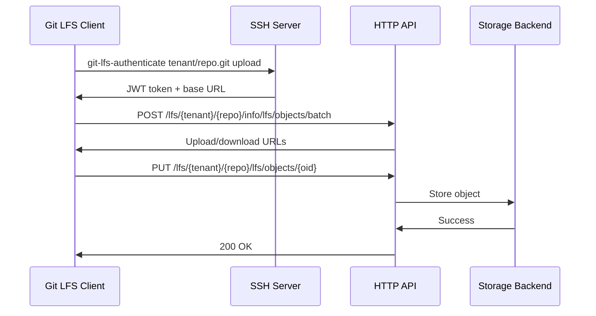

# Git LFS API Reference

This document describes the HTTP API endpoints provided by repos-mcp for Git LFS operations.

## Overview

The Git LFS API implements the [Git LFS Batch API specification](https://github.com/git-lfs/git-lfs/blob/main/docs/api/batch.md) for efficient large file transfers.

**Base URL**: Configured via `lfs.base_url` in configuration  
**Authentication**: JWT tokens obtained via SSH `git-lfs-authenticate` command  
**Transfer Protocol**: Basic transfer adapter (direct HTTP PUT/GET)

## Authentication Flow



## Endpoints

### Batch API

Request upload or download URLs for multiple objects.

**Endpoint**: `POST /lfs/{tenant}/{repo}/info/lfs/objects/batch`

**Path Parameters**:
- `tenant` (string): Tenant identifier
- `repo` (string): Repository name (e.g., `myrepo` or `myrepo.git`)

**Headers**:
```
Content-Type: application/vnd.git-lfs+json
Accept: application/vnd.git-lfs+json
Authorization: Bearer {jwt_token}
```

**Request Body**:
```json
{
  "operation": "upload",
  "transfers": ["basic"],
  "ref": {
    "name": "refs/heads/main"
  },
  "objects": [
    {
      "oid": "2c26b46b68ffc68ff99b453c1d30413413422d706483bfa0f98a5e886266e7ae",
      "size": 1024
    }
  ],
  "hash_algo": "sha256"
}
```

**Request Fields**:
- `operation` (string, required): Either `"upload"` or `"download"`
- `transfers` (array[string], optional): Transfer adapters supported. Default: `["basic"]`
- `ref` (object, optional): Git reference information
  - `name` (string): Git ref name (e.g., `"refs/heads/main"`)
- `objects` (array[object], required): List of objects to transfer
  - `oid` (string): SHA256 hash of object (64 hex characters)
  - `size` (integer): Object size in bytes
- `hash_algo` (string, optional): Hashing algorithm. Always `"sha256"`

**Response** (200 OK):
```json
{
  "transfer": "basic",
  "objects": [
    {
      "oid": "2c26b46b68ffc68ff99b453c1d30413413422d706483bfa0f98a5e886266e7ae",
      "size": 1024,
      "authenticated": true,
      "actions": {
        "upload": {
          "href": "http://localhost:8090/lfs/tenant/repo/lfs/objects/2c26b46b...",
          "expires_in": 3600
        }
      }
    }
  ],
  "hash_algo": "sha256"
}
```

**Response Fields**:
- `transfer` (string): Selected transfer adapter (`"basic"`)
- `objects` (array[object]): Response for each requested object
  - `oid` (string): Object ID from request
  - `size` (integer): Object size from request
  - `authenticated` (boolean): Whether authentication succeeded
  - `actions` (object, optional): Available operations (present if object can be transferred)
    - `upload` (object): Upload action details (for upload operation)
      - `href` (string): Upload URL
      - `expires_in` (integer): URL validity in seconds
    - `download` (object): Download action details (for download operation)
      - `href` (string): Download URL
      - `expires_in` (integer): URL validity in seconds
    - `verify` (object, optional): Verification endpoint (not currently implemented)
  - `error` (object, optional): Error details (present if object cannot be transferred)
    - `code` (integer): HTTP error code
    - `message` (string): Error description
- `hash_algo` (string): Hashing algorithm used

**Error Response** (for missing objects):
```json
{
  "transfer": "basic",
  "objects": [
    {
      "oid": "abc123...",
      "size": 1024,
      "authenticated": true,
      "actions": null,
      "error": {
        "code": 404,
        "message": "Object abc123... not found"
      }
    }
  ],
  "hash_algo": "sha256"
}
```

**Error Codes**:
- `404`: Object not found (download operation)
- `413`: Object exceeds `max_object_size` limit
- `422`: Size mismatch or validation error
- `500`: Storage error
- `503`: LFS service not enabled

### Upload Object

Upload a single LFS object.

**Endpoint**: `PUT /lfs/{tenant}/{repo}/lfs/objects/{oid}`

**Path Parameters**:
- `tenant` (string): Tenant identifier
- `repo` (string): Repository name
- `oid` (string): SHA256 object ID (64 hex characters)

**Headers**:
```
Content-Type: application/octet-stream
Content-Length: {size}
Authorization: Bearer {jwt_token}
```

**Request Body**: Binary object data

**Response** (200 OK): Empty body

**Error Responses**:
- `400 Bad Request`: Invalid OID format or missing data
- `401 Unauthorized`: Invalid or expired JWT token
- `413 Payload Too Large`: Object exceeds `max_object_size`
- `422 Unprocessable Entity`: SHA256 mismatch
- `500 Internal Server Error`: Storage error
- `503 Service Unavailable`: LFS not enabled

**Example**:
```bash
curl -X PUT "http://localhost:8090/lfs/acme/myapp/lfs/objects/2c26b46b..." \
  -H "Content-Type: application/octet-stream" \
  -H "Authorization: Bearer {token}" \
  --data-binary @largefile.bin
```

### Download Object

Download a single LFS object.

**Endpoint**: `GET /lfs/{tenant}/{repo}/lfs/objects/{oid}`

**Path Parameters**:
- `tenant` (string): Tenant identifier
- `repo` (string): Repository name
- `oid` (string): SHA256 object ID (64 hex characters)

**Headers**:
```
Accept: application/octet-stream
Authorization: Bearer {jwt_token}
```

**Response** (200 OK):
```
Content-Type: application/octet-stream
Content-Length: {size}

{binary data}
```

**Error Responses**:
- `400 Bad Request`: Invalid OID format
- `401 Unauthorized`: Invalid or expired JWT token
- `404 Not Found`: Object does not exist
- `500 Internal Server Error`: Storage error
- `503 Service Unavailable`: LFS not enabled

**Example**:
```bash
curl "http://localhost:8090/lfs/acme/myapp/lfs/objects/2c26b46b..." \
  -H "Authorization: Bearer {token}" \
  -o downloaded-file.bin
```

## Complete Request Flow

### Upload Flow

1. **Obtain JWT Token** (via SSH):
```bash
ssh git@server git-lfs-authenticate tenant/repo.git upload
```

Response:
```json
{
  "href": "http://localhost:8090",
  "header": {
    "Authorization": "Bearer eyJhbGc..."
  },
  "expires_at": "2026-01-22T00:30:00Z",
  "expires_in": 3600
}
```

2. **Request Upload URLs** (Batch API):
```bash
curl -X POST "http://localhost:8090/lfs/tenant/repo/info/lfs/objects/batch" \
  -H "Content-Type: application/vnd.git-lfs+json" \
  -H "Authorization: Bearer eyJhbGc..." \
  -d '{
    "operation": "upload",
    "objects": [{"oid": "2c26b46b...", "size": 1024}]
  }'
```

3. **Upload Object**:
```bash
curl -X PUT "http://localhost:8090/lfs/tenant/repo/lfs/objects/2c26b46b..." \
  -H "Content-Type: application/octet-stream" \
  -H "Authorization: Bearer eyJhbGc..." \
  --data-binary @file.bin
```

### Download Flow

1. **Obtain JWT Token** (via SSH):
```bash
ssh git@server git-lfs-authenticate tenant/repo.git download
```

2. **Request Download URLs** (Batch API):
```bash
curl -X POST "http://localhost:8090/lfs/tenant/repo/info/lfs/objects/batch" \
  -H "Content-Type: application/vnd.git-lfs+json" \
  -H "Authorization: Bearer eyJhbGc..." \
  -d '{
    "operation": "download",
    "objects": [{"oid": "2c26b46b...", "size": 1024}]
  }'
```

3. **Download Object**:
```bash
curl "http://localhost:8090/lfs/tenant/repo/lfs/objects/2c26b46b..." \
  -H "Authorization: Bearer eyJhbGc..." \
  -o file.bin
```

## Security Considerations

### JWT Tokens

- Tokens are scoped to:
  - Specific tenant
  - Specific repository
  - Specific operation (upload or download)
- Tokens expire after `lfs.token_expiration_secs` (default: 1 hour)
- Tokens are signed with `lfs.jwt_secret`

### Multi-Tenancy

- Path isolation: `/lfs/{tenant}/{repo}/...`
- JWT claims enforce tenant/repo boundaries
- Storage paths include tenant and repo for isolation

### Rate Limiting

Currently not implemented at LFS level. Consider:
- Reverse proxy rate limiting (nginx, HAProxy)
- Network-level throttling
- Future Phase 8 implementation

## Error Handling

All error responses follow this structure:

```json
{
  "message": "Error description"
}
```

Or for batch operations:

```json
{
  "transfer": "basic",
  "objects": [
    {
      "oid": "...",
      "size": 1024,
      "error": {
        "code": 404,
        "message": "Object not found"
      }
    }
  ]
}
```

### Common Error Scenarios

| Error | Code | Cause | Solution |
|-------|------|-------|----------|
| Object not found | 404 | Object doesn't exist | Verify OID, check storage |
| Object too large | 413 | Exceeds `max_object_size` | Increase limit or reduce file size |
| Size mismatch | 422 | Uploaded size ≠ declared size | Verify file integrity |
| Invalid token | 401 | Expired or invalid JWT | Re-authenticate via SSH |
| LFS disabled | 503 | `lfs.enabled = false` | Enable in configuration |

## Testing API Endpoints

### Test Batch Download (Object Not Found)

```bash
curl -X POST http://localhost:8090/lfs/test/repo/info/lfs/objects/batch \
  -H "Content-Type: application/vnd.git-lfs+json" \
  -d '{
    "operation": "download",
    "objects": [{"oid": "'"$(python3 -c 'print("a"*64)')"'", "size": 100}]
  }' | jq .
```

Expected: 404 error in response object.

### Test Upload + Download

```bash
# Create test file
echo "test content" > /tmp/test.bin
OID=$(sha256sum /tmp/test.bin | awk '{print $1}')

# Request upload URL
BATCH_RESP=$(curl -s -X POST http://localhost:8090/lfs/test/repo/info/lfs/objects/batch \
  -H "Content-Type: application/vnd.git-lfs+json" \
  -d "{\"operation\":\"upload\",\"objects\":[{\"oid\":\"$OID\",\"size\":13}]}")

# Upload object
curl -X PUT "http://localhost:8090/lfs/test/repo/lfs/objects/$OID" \
  -H "Content-Type: application/octet-stream" \
  --data-binary @/tmp/test.bin

# Download object
curl "http://localhost:8090/lfs/test/repo/lfs/objects/$OID" -o /tmp/test-downloaded.bin

# Verify
diff /tmp/test.bin /tmp/test-downloaded.bin && echo "Success!"
```

## Monitoring and Observability

### Recommended Metrics

Future implementation (Phase 8) should track:

- **Upload/Download counts**: By tenant, repo, operation
- **Object sizes**: Distribution, total storage used
- **Request latency**: p50, p95, p99 for each endpoint
- **Error rates**: By error code and endpoint
- **Token generation rate**: Authentication patterns
- **Storage usage**: Per tenant/repo

### Logging

Current implementation logs:
- LFS feature initialization
- Route configuration
- Errors during object operations

Log format: Structured logs via `tracing` crate

## Standards Compliance

This implementation follows:
- [Git LFS Batch API v1](https://github.com/git-lfs/git-lfs/blob/main/docs/api/batch.md)
- [Git LFS Basic Transfer](https://github.com/git-lfs/git-lfs/blob/main/docs/api/basic-transfers.md)
- JWT authentication via SSH (repos-mcp specific)

## Related Documentation

- [LFS Configuration Reference](./LFS_CONFIGURATION.md) - Server configuration
- [LFS Security Model](./LFS_SECURITY.md) - Authentication and authorization
- [Git LFS Official Docs](https://git-lfs.com/) - Client documentation
